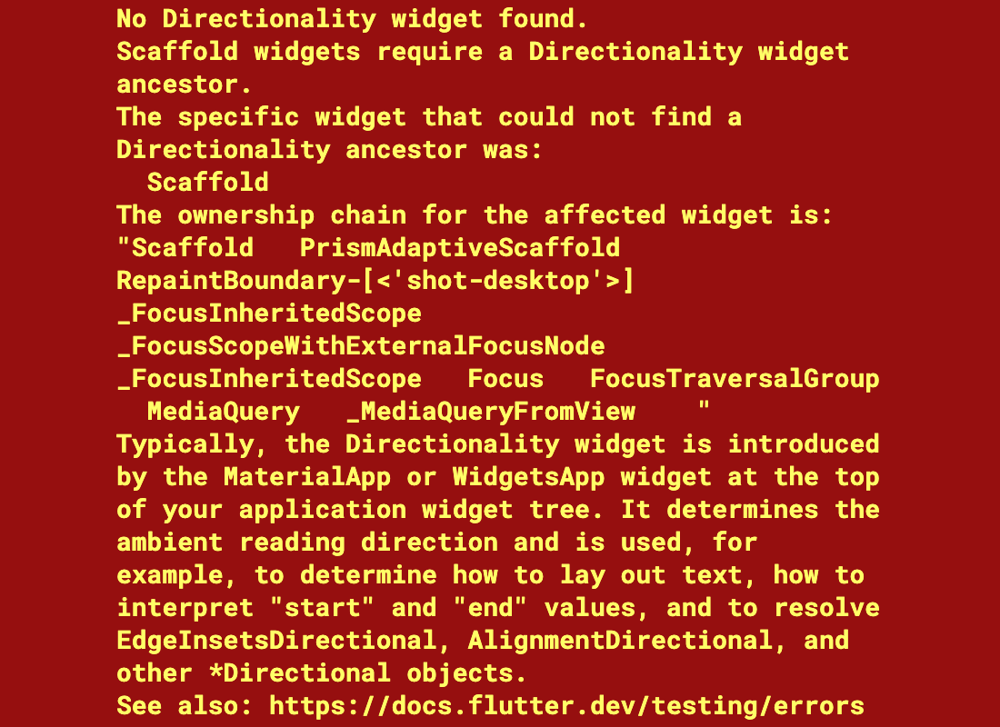
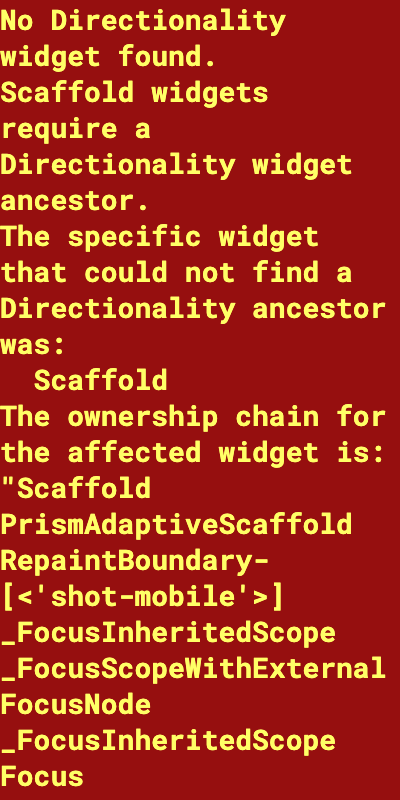

# prism_adaptive_scaffold

A **responsive adaptive scaffold for Flutter** — the maintained replacement
for the discontinued `flutter_adaptive_scaffold`. One widget, three layouts:
bottom navigation bar on phones, a navigation rail on tablets, and an
extended rail with labels on desktop. Pure Flutter — no platform channels.

## Features

- ✅ Material 3 adaptive navigation: bottom bar → rail → extended rail
- ✅ Canonical M3 breakpoints (compact / medium / expanded / extra-large)
- ✅ Animated body transitions between destinations
- ✅ Drop-in API: pass destinations + a body builder, done
- ✅ Works on all six Flutter platforms: Android, iOS, macOS, Windows, Linux, Web

## Installation

```yaml
dependencies:
  prism_adaptive_scaffold: ^0.1.0
```

## Usage

```dart
import 'package:flutter/material.dart';
import 'package:prism_adaptive_scaffold/prism_adaptive_scaffold.dart';

PrismAdaptiveScaffold(
  destinations: const [
    AdaptiveDestination(icon: Icons.inbox_outlined, label: 'Inbox'),
    AdaptiveDestination(icon: Icons.send_outlined, label: 'Sent'),
  ],
  currentIndex: _index,
  onDestinationSelected: (i) => setState(() => _index = i),
  bodyBuilder: (index) => Center(child: Text('Page $index')),
)
```

Resize the window (or run on desktop) and watch the navigation adapt.

## Custom breakpoints

Pass your own thresholds to `PrismBreakpoint.resolve`, or compare directly:

```dart
final bp = PrismBreakpoint.resolve(MediaQuery.sizeOf(context).width);
if (bp == PrismBreakpoint.expanded) {
  // Show a two-pane layout.
}
```

## The Prism package family

Part of a cohesive adaptive-UI suite — pair the scaffold with adaptive dialogs for correct UX on every screen size:

| Package | What it does |
| --- | --- |
| [prism_markdown](https://pub.dev/packages/prism_markdown) | Markdown widget with full CommonMark + GFM support |
| [prism_code_view](https://pub.dev/packages/prism_code_view) | Syntax-highlighted code viewer (Dart/JSON/YAML built in) |
| [prism_adaptive_scaffold](https://pub.dev/packages/prism_adaptive_scaffold) | Responsive scaffolds: bottom bar → rail → extended rail |
| [prism_adaptive_dialog](https://pub.dev/packages/prism_adaptive_dialog) | Dialogs that become bottom sheets on phones |

All pure Flutter, all six platforms, MIT licensed, built to work together.

## Screenshots

<p align="center">
  
  
</p>

## License

MIT — see [LICENSE](LICENSE).
